# SAP-EPC

BESS Hafen-West 储能电站（50 MW / 100 MWh）的 12 张 SAP S/4HANA 风格界面图，按需求编号 01–12。

[下载完整 ZIP](https://github.com/6234456/SAP-EPC/archive/refs/heads/codex-bess-s4hana-ui-images-20261002.zip) · [双语 CSV 目录](catalog/bess-s4hana-ui.csv) · [业务与版本说明](docs/bess-s4hana-ui.md)

图片由 GPT Image 生成，采用统一 SAP Horizon 风格；图片内不添加“模拟界面”文字。具体事务、字段、客户扩展及版本适用范围见说明文件。

通过 GitHub 原生 ZIP 下载本分支的全部文件，包含 12 张 1672 × 941 PNG、README、业务说明、CSV 目录和 HTML 浏览索引。解压后打开 gallery/index.html 可按编号浏览。

## 目录

| No. | English / Deutsch | T-code / Module | PNG |
| --- | --- | --- | --- |
| 01 | WBS Structure Overview WBS-Strukturübersicht | CN41N / CJ20N | [打开](assets/bess-s4hana/01_WBS_Structure_Overview_CN41N.png) |
| 02 | Budget Availability Control Budgetverfügbarkeitskontrolle | CJ30 / CJ31 / CJ32 | [打开](assets/bess-s4hana/02_Budget_Availability_Control_CJ31.png) |
| 03 | Construction Progress Report – Excel Entry Baufortschrittsbericht – Excel-Erfassung | /SAPPCE/PNV08 | [打开](assets/bess-s4hana/03_Construction_Progress_Excel_Entry_PNV08.png) |
| 04 | Construction Progress Report – Display Baufortschrittsbericht – Anzeige | /SAPPCE/PNV09 | [打开](assets/bess-s4hana/04_Construction_Progress_Display_PNV09.png) |
| 05 | Project Cost/Revenue Comparison Report Projektkosten-/Erlösvergleichsbericht | CN41N / CJE0 | [打开](assets/bess-s4hana/05_Project_Cost_Revenue_Comparison_CJE0.png) |
| 06 | Network Confirmation Netzwerkbestätigung | CN25 | [打开](assets/bess-s4hana/06_Network_Confirmation_CN25.png) |
| 07 | Results Analysis / POC Ergebnisanalyse / Fertigstellungsgrad (POC) | KKA2 | [打开](assets/bess-s4hana/07_Results_Analysis_POC_KKA2.png) |
| 08 | Settlement to FI Abrechnung an FI | CJ88 | [打开](assets/bess-s4hana/08_Settlement_to_FI_CJ88.png) |
| 09 | Service Contract & Maintenance Plan Assignment Servicevertrag & Wartungsplan-Zuordnung | VA41 / IP01 / IP02 | [打开](assets/bess-s4hana/09_Service_Contract_Maintenance_Plan_IP02.png) |
| 10 | Service Order Execution Serviceauftragsbearbeitung | IW31 / IW32 / IW33 | [打开](assets/bess-s4hana/10_Service_Order_Execution_IW32.png) |
| 11 | Service History & Equipment/Product Master Servicehistorie & Equipment-/Produktstammdaten | IE03 / IW39 | [打开](assets/bess-s4hana/11_Service_History_Equipment_IE03.png) |
| 12 | Loss Provision / Revenue Deferral / Contract Liability Drohverlustrückstellung / Umsatzabgrenzung / Vertragsverbindlichkeit | KKA2 / CJ88 / Revenue Accounting | [打开](assets/bess-s4hana/12_Loss_Provision_Contract_Liability_KKA2.png) |

## 图片预览

### 01 · WBS Structure Overview

WBS-Strukturübersicht · CN41N / CJ20N

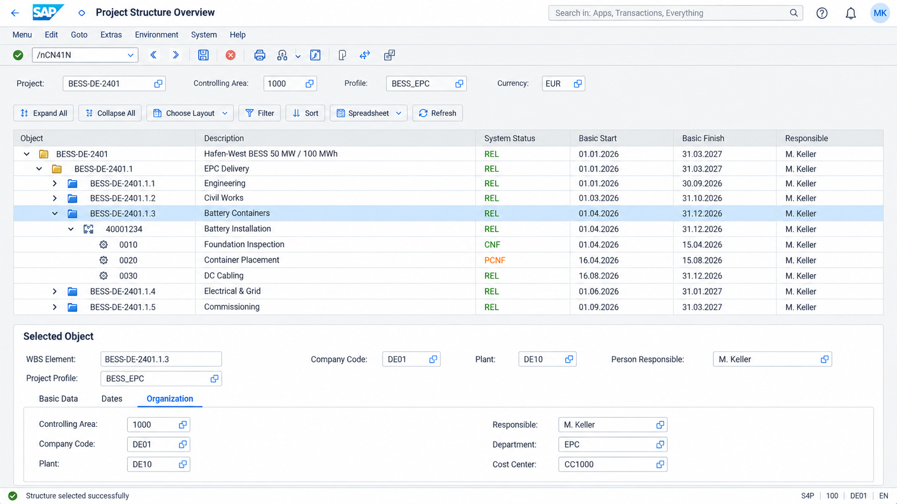

### 02 · Budget Availability Control

Budgetverfügbarkeitskontrolle · CJ30 / CJ31 / CJ32

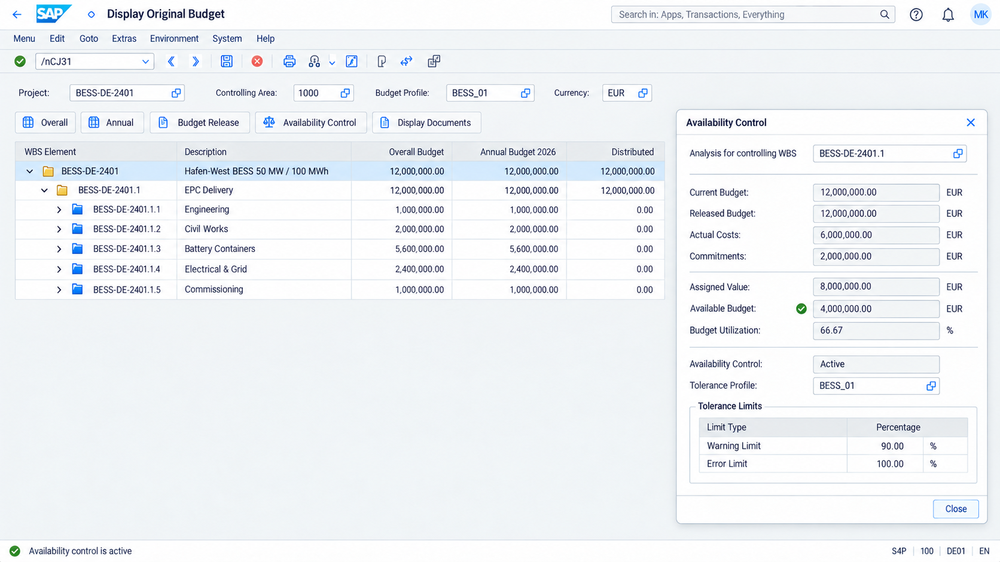

### 03 · Construction Progress Report – Excel Entry

Baufortschrittsbericht – Excel-Erfassung · /SAPPCE/PNV08

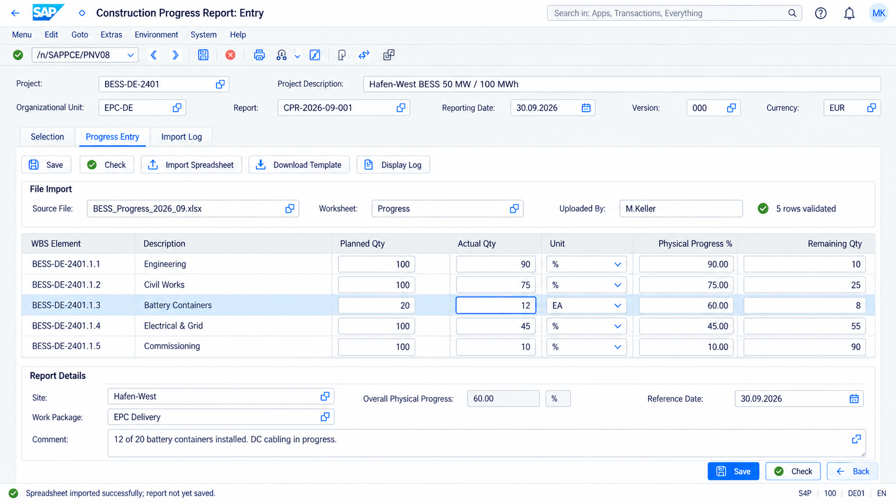

### 04 · Construction Progress Report – Display

Baufortschrittsbericht – Anzeige · /SAPPCE/PNV09

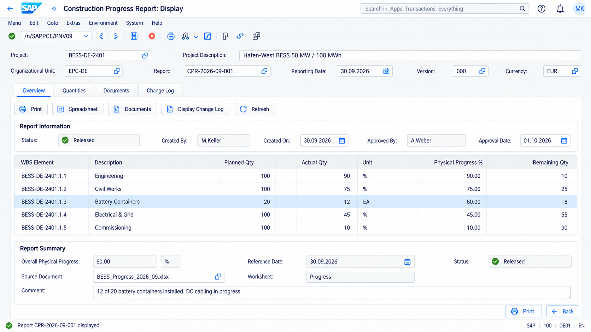

### 05 · Project Cost/Revenue Comparison Report

Projektkosten-/Erlösvergleichsbericht · CN41N / CJE0

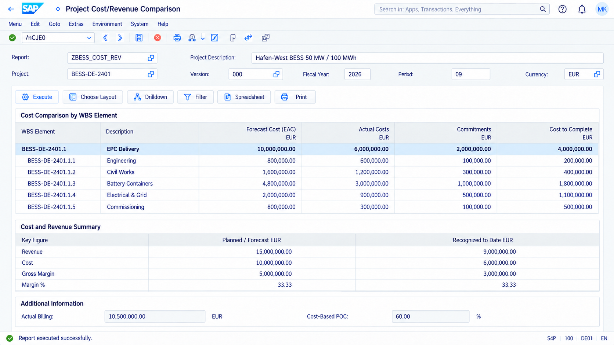

### 06 · Network Confirmation

Netzwerkbestätigung · CN25

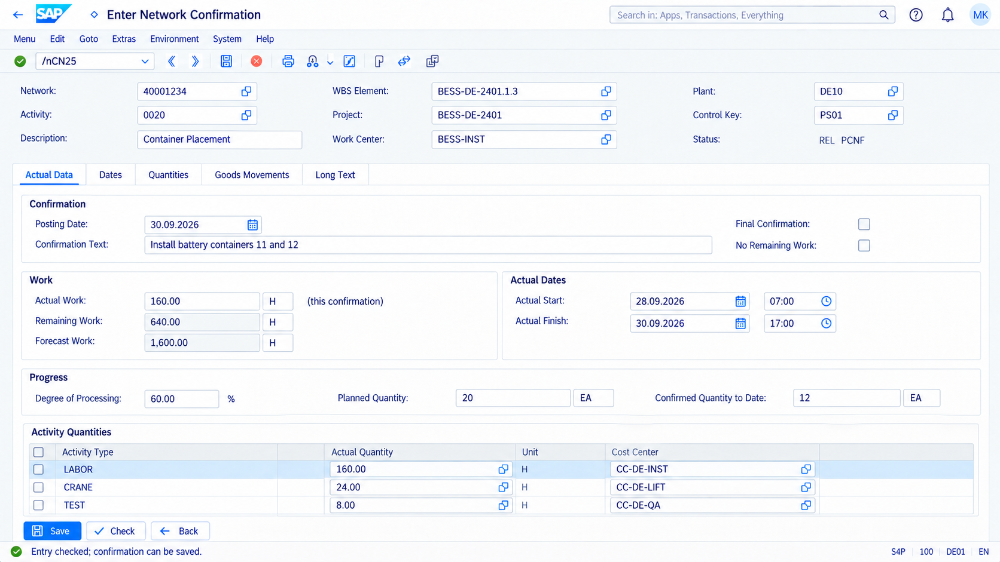

### 07 · Results Analysis / POC

Ergebnisanalyse / Fertigstellungsgrad (POC) · KKA2

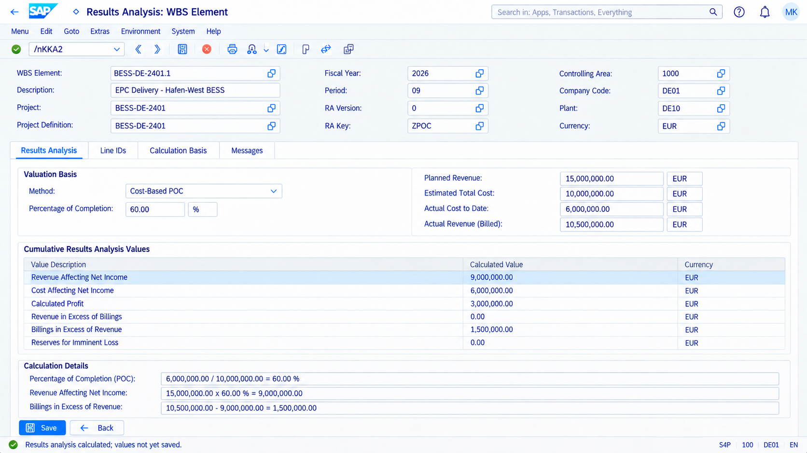

### 08 · Settlement to FI

Abrechnung an FI · CJ88

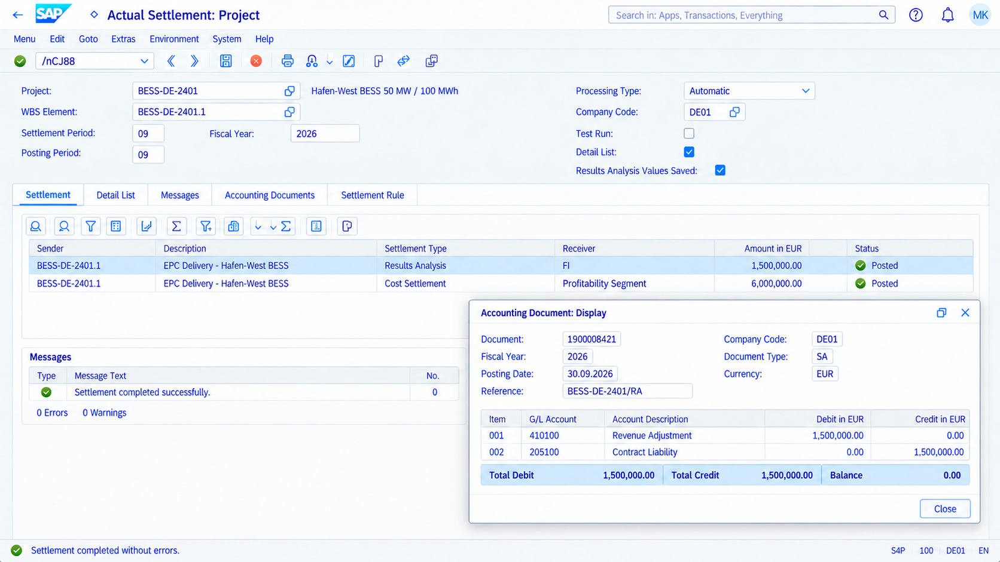

### 09 · Service Contract & Maintenance Plan Assignment

Servicevertrag & Wartungsplan-Zuordnung · VA41 / IP01 / IP02

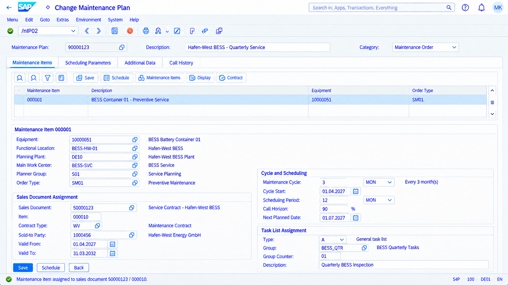

### 10 · Service Order Execution

Serviceauftragsbearbeitung · IW31 / IW32 / IW33

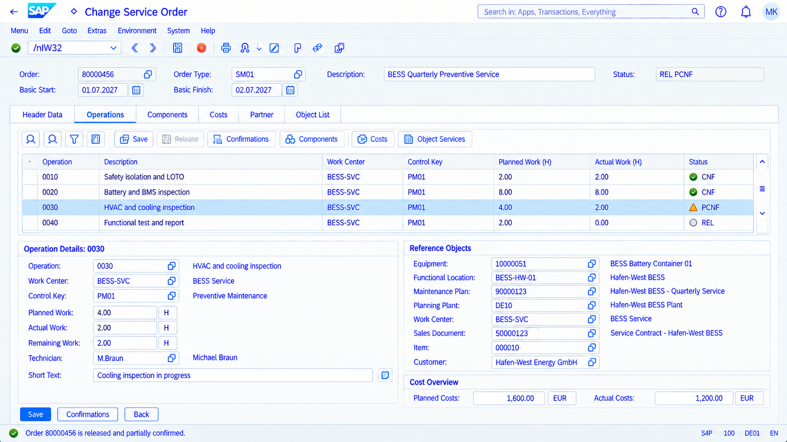

### 11 · Service History & Equipment/Product Master

Servicehistorie & Equipment-/Produktstammdaten · IE03 / IW39

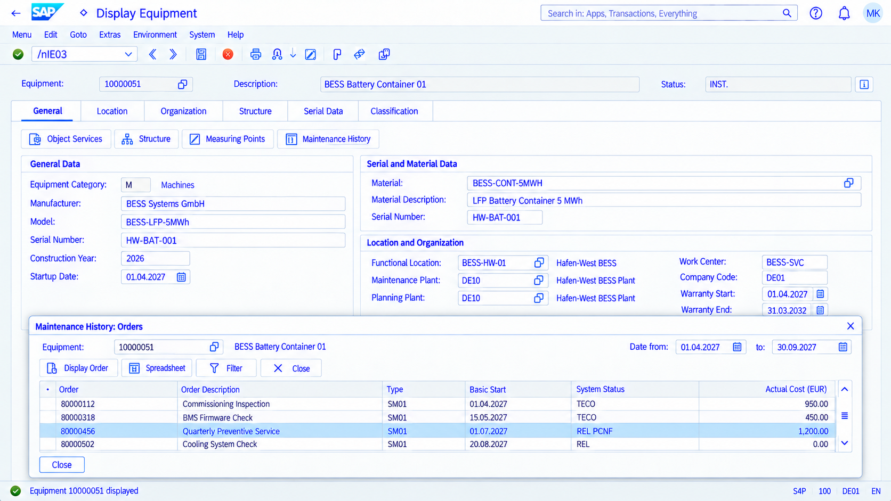

### 12 · Loss Provision / Revenue Deferral / Contract Liability

Drohverlustrückstellung / Umsatzabgrenzung / Vertragsverbindlichkeit · KKA2 / CJ88 / Revenue Accounting

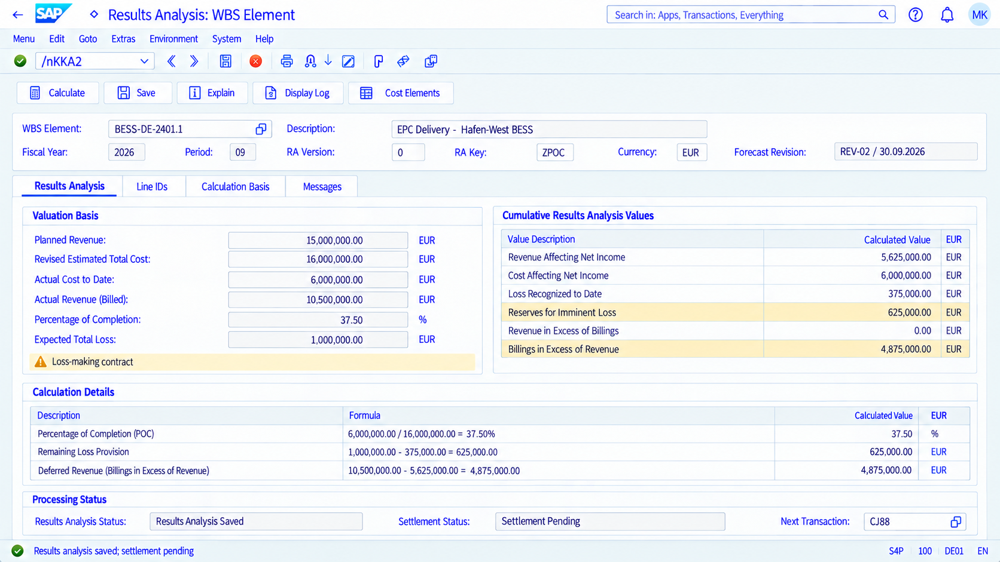
